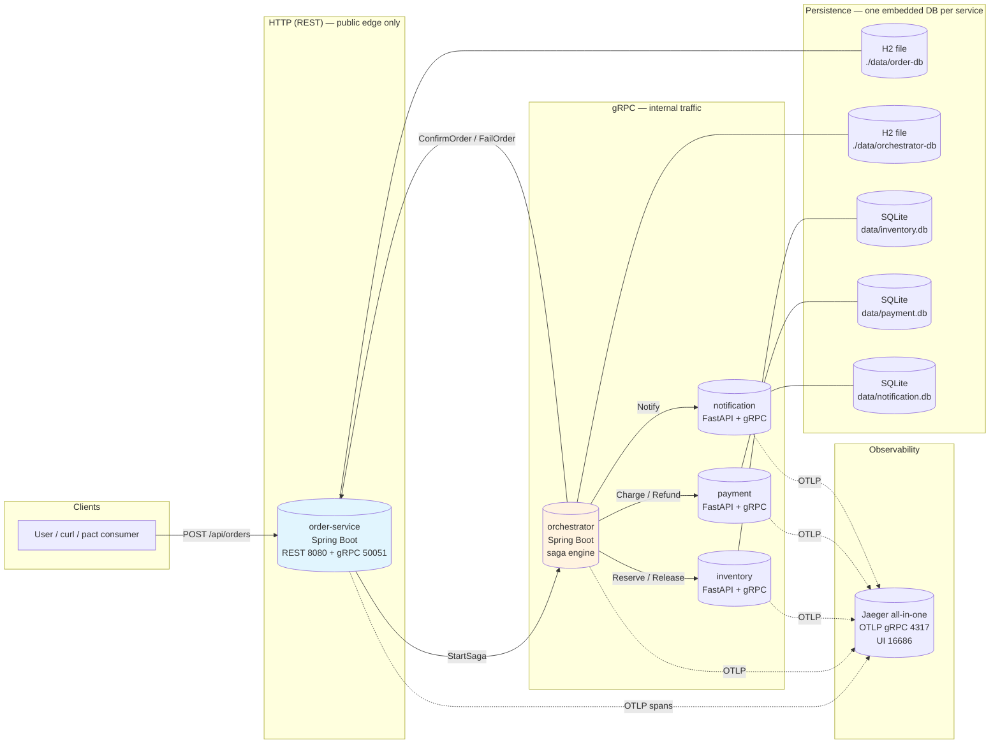
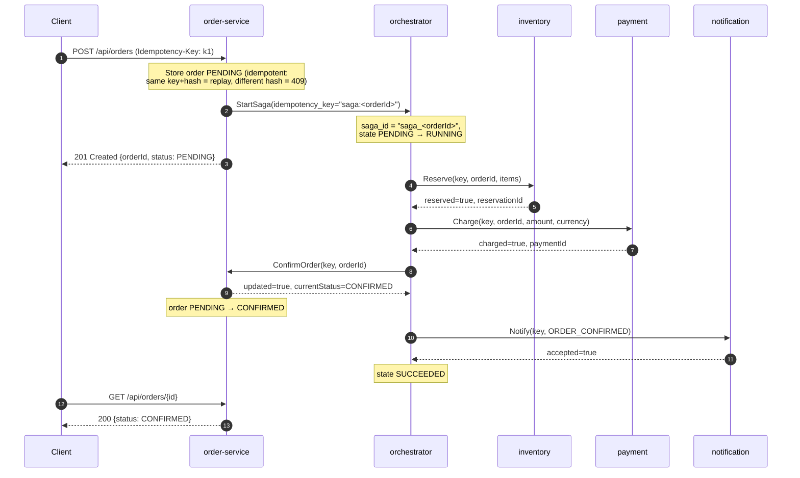
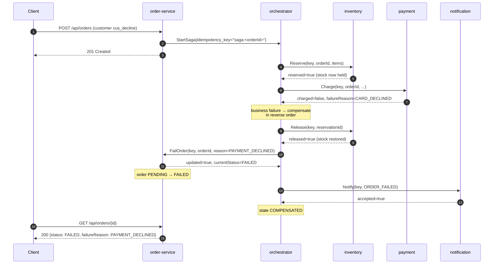

# Architecture — saga-based order & inventory system

Five microservices, one distributed saga, one trace pipeline. The frozen
interface agreement lives in [CONTRACT.md](CONTRACT.md); this document explains
*how the pieces fit together* and mirrors contract §3.

## Component diagram

Rules of the road (contract §2):

- **REST exists only on order-service** (`POST/GET /api/orders`,
  `GET /actuator/health`). Everything else speaks gRPC.
- Inside docker-compose / Kubernetes **every service listens on HTTP 8080 and
  gRPC 50051**; local dev uses distinct default ports (see README).
- All five services export OTLP/gRPC spans to Jaeger
  (`OTEL_EXPORTER_OTLP_ENDPOINT`, contract §3.7). Java services use the
  zero-code OpenTelemetry agent via `JAVA_TOOL_OPTIONS`; the Python services
  instrument FastAPI and gRPC in-process.

## Saga states

One saga per order, `saga_id = "saga_" + order_id`; `StartSaga` is idempotent
(contract §3.1).

| State         | Meaning                                                              |
|---------------|----------------------------------------------------------------------|
| `PENDING`     | Persisted, not yet executing (or waiting to start).                  |
| `RUNNING`     | Steps executing in order.                                            |
| `SUCCEEDED`   | All steps done: `RESERVE_INVENTORY → CHARGE_PAYMENT → CONFIRM_ORDER → NOTIFY`. |
| `FAILED`      | A step failed **before** anything needing compensation (e.g. reserve failed, or saga machinery error). Order → `FAILED` with a reason code. |
| `COMPENSATED` | A post-reserve step failed; compensation ran in reverse; order → `FAILED`. |

Step names: `RESERVE_INVENTORY`, `CHARGE_PAYMENT`, `CONFIRM_ORDER`,
`RELEASE_INVENTORY`, `REFUND_PAYMENT`, `NOTIFY`. Business outcomes always ride
in **response fields**, never in gRPC status codes; non-OK statuses are
technical failures only (`UNAVAILABLE`, `DEADLINE_EXCEEDED`, `INTERNAL`), which
the orchestrator retries (`ORCHESTRATOR_MAX_RETRIES` ×
`ORCHESTRATOR_RETRY_BACKOFF_MS`) before compensating.

## Happy path

## Payment declined → compensating release

Failure handling summary (contract §3.1):

- **Reserve fails** (insufficient stock / unknown SKU) → nothing to compensate
  → `FailOrder(INSUFFICIENT_STOCK)` + notify → saga `FAILED`.
- **Charge fails** (card declined) → `RELEASE_INVENTORY` →
  `FailOrder(PAYMENT_DECLINED)` + notify → saga `COMPENSATED`.
- **Confirm fails** → `REFUND_PAYMENT` → `RELEASE_INVENTORY` →
  `FailOrder(ORDER_UPDATE_FAILED)` + notify → saga `COMPENSATED`.
- **Technical failure** of a call → retry with backoff, then treat as a failure
  of that step and compensate whatever succeeded
  (`INVENTORY_UNAVAILABLE`, `PAYMENT_UNAVAILABLE`).
- **Notify is best-effort** — recorded in the step detail, never fails or
  compensates the saga.

## Idempotency & concurrency story

**REST edge (order-service).** `POST /api/orders` takes an `Idempotency-Key`
header. The key + a hash of the request body are stored in the same
transaction as the order row: same key + same body replays the original order
with **200** (instead of 201); same key + different body returns **409
IDEMPOTENCY_CONFLICT** (contract §3.2).

**gRPC everywhere.** Every RPC carries an `idempotency_key`, generated
deterministically (e.g. `charge:<orderId>`) so transport-level retries can
never double-execute. The FastAPI services keep an `idempotency_records` table
(key → request hash → stored response) in the **same SQLite transaction** as
the business row: a replay with the same hash returns the stored response (even
a *failed* charge replays the same `CARD_DECLINED`), and a different hash yields
`IDEMPOTENCY_CONFLICT` (contract §3.3). `StartSaga` is idempotent per order:
duplicates return the existing saga id.

**Order state machine.** `ConfirmOrder`/`FailOrder` are idempotent and
one-way: a CONFIRMED order can never go FAILED and vice versa — the second call
returns `updated=false` plus the current status (contract §3.2).

**Inventory — optimistic locking.** The `stock` table carries a `version`
column used as SQLAlchemy's `version_id_col`. A reserve transaction reads the
row, adjusts `available`/`reserved`, and writes back with the expected version;
a concurrent update raises `StaleDataError`, and the whole transaction is
retried up to 5 times before returning `reserved=false,
failure_reason="CONFLICT"` (contract §3.4). Together with atomic validation of
all reservation lines (any shortage ⇒ **no rows changed**), this makes
overselling impossible: 10 concurrent reserves against 1 unit of stock yield
exactly one winner (verified by the mandatory concurrency test).

## Distributed tracing

Jaeger all-in-one receives OTLP on 4317; its UI/API is on 16686. Service names
in Jaeger come from `OTEL_SERVICE_NAME`: `order-service`, `orchestrator`,
`inventory-service`, `payment-service`, `notification-service`. One order
travels through four process boundaries (REST → gRPC → gRPC → gRPC); W3C trace
context is propagated through gRPC metadata automatically by the OTel grpc
instrumentation, so a single trace shows the full causal chain —
`POST /api/orders` → `StartSaga` → saga step spans (`RESERVE_INVENTORY`,
`CHARGE_PAYMENT`, …) → each downstream call. `scripts/e2e.sh` scenario 5
asserts this pipeline end-to-end via the Jaeger API.
